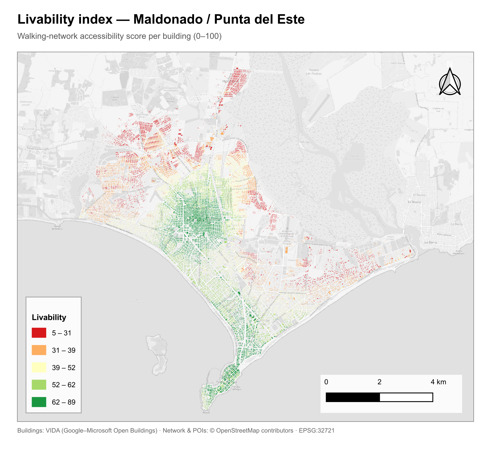

# Agentic livability score for all buildings in the Maldonado/Punta del Este conglomerate

## Introduction

Maldonado and Punta del Este are two coastal cities placed in the Maldonado department, in the East of Uruguay. Punta del Este is a well know tourist destination, 
so during the summer it receives a big contingent of high income tourists from all
over the world, but mainly from Argentina.

In this project I created a livabilty score, prompting Claude to download
geospatial data and generate some spatial calculations, for which I consider
are some features that make a city "livable" and al culturally aligned with
the taste of the uruguayan population.

The score and the selection of the variable has no other theoretical
base but my own decisions, and is neither is backed by research. It's just my personal
interpretation of what people would expect to enjoy while living in a city, 
restricted by the data availability and completeness.

## Key data

Building footprints come from the [VIDA Google-Microsoft Open Buildings](https://source.coop/vida/google-microsoft-open-buildings) dataset (78,359 buildings).
All other data comes from OpenStreetMap, accessed through osmnx:

| Layer | OSM tags |
|---|---|
| Coastline | `natural=coastline` |
| Beaches | `natural=beach` |
| Green areas | `leisure=park/garden/playground`, `place=square` (parks); plus forests, grass, woods, etc. |
| Amenities | `amenity=restaurant/cafe/bar` |
| Public transport hubs | `amenity=bus_station`, `public_transport=station` |
| Bus stops | `highway=bus_stop` |
| Street network | all street types (`network_type="all"`) |

## The score

All distances are walking distances along the street network, not straight lines. A 15-minute walk is taken as 1,200 m.

The variables measured were:

| Theme | Variable |
|---|---|
| Services | Mean distance to the 5 nearest amenities |
| | Amenities within a 15-minute walk |
| | Detour index: walking distance to the nearest amenity divided by the straight-line distance |
| Transport | Distance to the nearest bus stop |
| | Bus stops within a 15-minute walk |
| | Distance to the nearest transport hub |
| Green | Mean distance to the 5 nearest green areas |
| | Parks within a 15-minute walk |
| Coast | Distance to the nearest beach |
| | Distance to the coastline |

Each variable was capped at its 95th percentile and scaled from 0 to 1, with 1 always meaning better. Variables were averaged within each theme, then the themes were combined with these weights: services 0.35, transport 0.25, green 0.25 and coast 0.15. The result is a single `livability` score from 0 to 100.

The coast gets a low weight on purpose. Otherwise the score would mostly measure distance to the beach, since most amenities also sit near the coast.

## Results and validation

The results of the agentic score are reasonable, but we can't state the accuracy. There may be bugs and errors in the code that we can't see, even upon thourogh review of the code created.
The way to handle this would be to code a set of tests that ensure that what we've got is what we asked.
Since that task is beside the scope, I decided to prompt Claude to make one last notebook with a comparison fo distances between 10 random buildings and the features used to measure the score, using both the osmnx and Open Route Service.
Some differences where detected, mainly in the conection to coast and beaches to the network.

## Final remarks

As I mentioned before, to propperly build a livebility score I would rely on more complex methdology, for example qualitative research on what people consider "livable", upon which I would get or produce the data needed. So this remains as a simple excerice.

Second, I consider really import to be aware that the results of the code that Claude provide may content error, so a throrugh framework for testing adn debbugin is needed if the code will be deployed in production environments or used in research.

Finally, I want to emphaise on the capabilities of agents for data anlytics i the geospatial real, since, withouth AI, an excerise like the one I'm reporting would probably took more than 100 hours of my work, but I managed to produce an outcome in a fraction of that time. Without any doubts, the emergence of agents is groundbreaking.